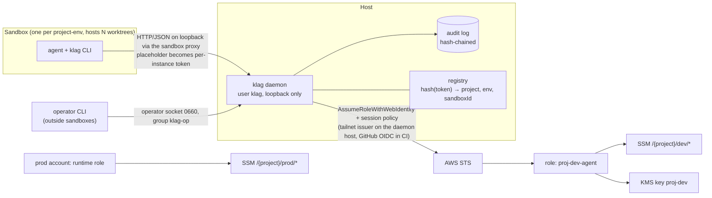
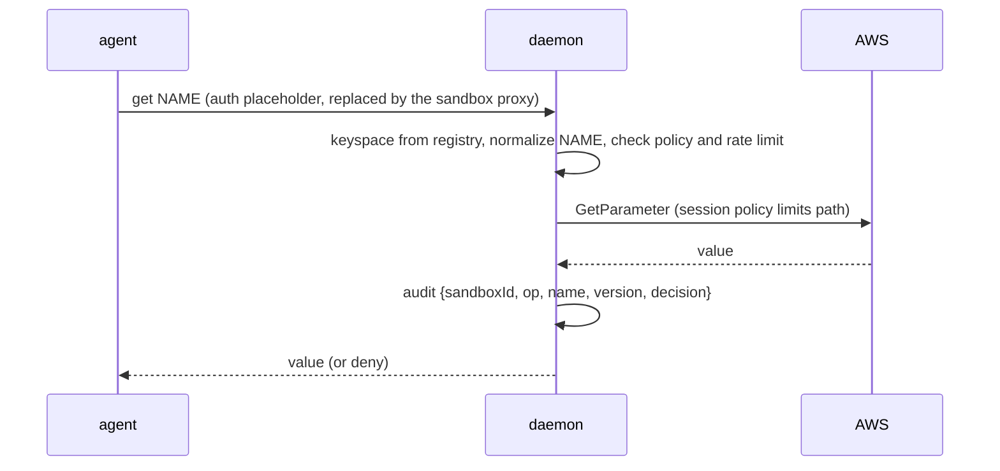

# klag specification (v2, implementable draft)

Package `klag` (npm), command `klag`, repository `keyless-agents`, TypeScript, MIT.
Requirements, tests and quality gates live in [REQUIREMENTS.md](REQUIREMENTS.md); inputs and outputs in [INTERFACES.md](INTERFACES.md); this file only describes the design.

## 1. Goal
Let coding agents use project credentials with no static cloud keys on machines, in git or in CI, and without trusting an agent with more than one project-env keyspace.

## 2. Trust model
| Actor | Trust | Role |
|---|---|---|
| **agent** | untrusted (may be prompt-injected) | runs inside one sandbox, calls `klag` |
| **operator** | trusted, always outside any sandbox | human or operator assistant; owns infra, promotes values, revokes sandboxes |
| **runtime** | trusted, prod only | production service role; reads prod directly from AWS and never uses `klag` |

Dev values are *burnable*: every dev secret must be scoped and revocable. With `get: value` the agent sees the value and can send it anywhere the sandbox network allows, so egress control belongs to the sandbox runtime.

## 3. Architecture

Prod sits in a separate AWS account that no dev role can reach. The daemon has no prod code path.

## 4. Identity binding
- The daemon listens on host loopback only (HTTP/JSON, one object per request). A sandbox reaches it through the runtime's host-side proxy, which replaces a placeholder in the `auth` field (body or header, never the query string) with a **per-instance token** scoped to that sandbox (`sbx secret set-custom … --sandbox`, experimental). The agent never sees the token.
- The registry stores only `hash(token) → {project, env, sandboxId}`, and the keyspace always comes from it. A request carrying `project` or `env` is `INVALID` and audited as an anomaly. An unreplaced placeholder or an unknown token is `DENIED`, audited with `decision: alert`.
- Token lifecycle: `klag op sandbox add <sandboxId> <project> <env>` stores the hash and prints a random token (≥128 bits) once, to be piped straight into the runtime's secret store. It lives as long as the sandbox; `revoke` deletes the hash. No token exists for any process outside a registered sandbox.
- The operator socket is mode 0660, group `klag-op`, owned by the dedicated `klag` user, whose state holds the hashes. Until every agent runs in a real sandbox the host as a whole is outside the trust model (premise P8): the daemon serves no one without a registry entry.
- `taskId`, sent by the agent, is advisory: it labels audit lines and the task scope for cleanup and never grants anything.

### 4.1 Sandbox granularity
The security boundary is the keyspace, and all worktrees of a project-env share it, so **one sandbox serves one project-env and many worktrees**. Agents on different worktrees of the same project-env have the same trust and read the same shared values, so splitting them adds no secret isolation and only multiplies parameters and memory. Per-worktree sandboxes stay available (`isolate: task`) for untrusted code or risky tasks; they then get their own token and task scope but still the same keyspace.

## 5. Keyspaces and operations
| Operation | Agent in dev | Operator | Prod |
|---|---|---|---|
| `list` | names under `/{project}/dev/` (values stripped) | all | agent: `not found` |
| `get` | `value` (policy `deny` available) | allowed | agent: `not found` |
| `set` | `/{project}/dev/agent/*` (project scope) or `/{project}/dev/agent/tasks/<taskId>/*` (task scope) | any dev path | agent: `not found` |
| `promote` | no | copies an agent value into `/{project}/dev/*` | no |
| `delete`, `revoke` | no | yes | no |

`get NAME` resolves shared (`/{project}/dev/*`) first, then task scope, then project scope, so an agent value never shadows a shared one. `gc` removes a task scope when its task closes. The agent has no `--env`: its environment is fixed by the registry, so prod does not exist for it.
Path template: `/{project}/{env}/{name}` and `/{project}/{env}/agent/…`. `tasks` is reserved under the agent scope; names starting with `aws` or `ssm` are rejected (SSM limit); depth ≤ 15. Shared paths across projects do not exist; cross-project access needs an explicit operator grant.

## 6. AWS layout (created by the CDK construct)
- **Accounts**: dev and prod in separate AWS accounts. The dev role has no trust or action toward prod.
- **Role per project-env** (`proj-dev-agent`): `ssm:GetParameter`, `GetParameters`, `GetParametersByPath` on `parameter/{project}/dev/*`; `ssm:PutParameter` only on `parameter/{project}/dev/agent/*`; explicit `Deny` on `DeleteParameter(s)`, on any `prod` path and on other projects. A permission boundary caps the role. `DescribeParameters` is not granted (it lists names of every project in the account); listing uses `GetParametersByPath`.
- **KMS**: one key per project-env, key policy naming only its roles, `kms:ViaService = ssm.<region>.amazonaws.com`. The read role has `Decrypt` only.
- **Trust**: in CI, the GitHub OIDC provider with exact `aud` and `sub` (repo and environment). On dev machines the target is a **tailnet OIDC issuer** (`tsidp` or `tsiam`): the daemon's host is a dedicated tailnet node with its own tag, and the role trusts that exact `sub` and `aud`, so there is no human login and no stored token. The issuer must be reachable by AWS to fetch its public keys (the spike M19 validates this). Until the spike passes, an IAM Identity Center profile with `sts:AssumeRole` is the fallback (`auth.type: profile`). Short sessions; a session policy narrows the role per request. **Sandboxes never join the tailnet and hold no AWS identity**; only the daemon's host does.
- **Store**: SSM Parameter Store `SecureString` (path hierarchy gives prefix-based IAM at no cost). The daemon forces `Type=SecureString` with the project key (IAM has no condition for the type, to validate); CloudTrail reveals other types written outside the daemon. Rotation is out of the MVP; Secrets Manager is a possible later adapter.
- Machine setup (sandbox runtime, network identity, AWS profile) is done with Ansible. CDK and Ansible hold names and paths only, never values.

## 7. Audit, limits and revocation
- Audit log: JSONL, append-only, each line carries the hash of the previous one, file owned by the daemon user (0600). Fields: timestamp, sandboxId, taskId (advisory), operation, name, version, decision. Never values. CloudTrail is the independent second record.
- Rate limit per sandbox with burst; a `list` sweep followed by `get` of every name raises an alert; in the MVP an alert is an audit line with `decision: alert`, external delivery is G4.
- `klag op revoke <sandboxId>` deletes the token hash, so the next request is denied.

## 8. CLI and daemon hygiene
- `set` reads the value from stdin or a prompt, never argv. Values never appear in argv, logs, error messages, stack traces, process title or the audit log. AWS SDK errors are sanitized before they leave the daemon.
- The daemon runs unprivileged, with core dumps disabled and non-dumpable memory, socket mode 0600 and systemd hardening.
- `process.env` is read only in the config module.
- The daemon never listens outside loopback; the VM → proxy hop is plain HTTP inside the sandbox private network (accepted).

## 9. Supply chain
Publish with npm trusted publishing (GitHub OIDC, no npm token) and provenance. Lockfile committed, exact dependency versions, minimal runtime dependencies, GitHub Actions pinned by commit SHA, 2FA for maintainers, secret scanning in CI.

## 10. To validate before coding
- Whether one sandbox can serve several Orca worktrees (mount their parent directory) and how the orchestrator starts agents inside it.
- That the sandbox proxy reaches a loopback daemon and that `set-custom` (experimental) substitutes the placeholder in a header or body; the placeholder format may change.
- Spike M19: a tailnet issuer (`tsidp` is experimental, `tsiam` is third-party) that AWS STS can reach, `AssumeRoleWithWebIdentity` pinned to the daemon node, session-policy behavior, and the limits of the profile fallback.
- Linux support level of the chosen sandbox runtime on non-Ubuntu distributions (best effort until tested).
- npm trusted-publishing setup for a new package.
