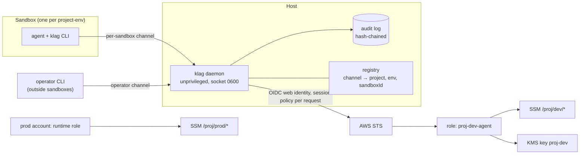
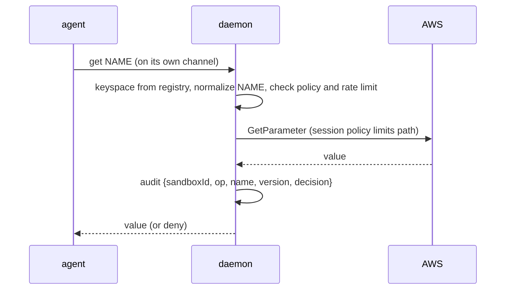

# klag specification (v2, implementable draft)

Package `klag` (npm), command `klag`, repository `keyless-agents`, TypeScript, MIT.
Requirements, tests and quality gates live in [REQUIREMENTS.md](REQUIREMENTS.md); this file only describes the design.

## 1. Goal
Let coding agents use project credentials with no static cloud keys on machines, in git or in CI, and without trusting an agent with more than one project-env keyspace.

## 2. Trust model
| Actor | Trust | Role |
|---|---|---|
| **agent** | untrusted (may be prompt-injected) | runs inside one sandbox, calls `klag` |
| **operator** | trusted, always outside any sandbox | human or operator assistant; owns infra, promotes values, revokes sandboxes |
| **runtime** | trusted, prod only | production service role; reads prod directly from AWS and never uses `klag` |

Dev values are *burnable*: every dev secret must be scoped and revocable. With `get: value` the agent sees the value and can send it anywhere the sandbox network allows, so egress control belongs to the sandbox runtime.

## 3. Architecture

Prod sits in a separate AWS account that no dev role can reach. The daemon has no prod code path.

## 4. Identity binding
- The daemon opens **one listener per sandbox** (unix socket or vsock mounted only into that sandbox). The channel is the identity, so there is no secret to steal. The registry maps channel → `{project, env, sandboxId}`.
- The keyspace is always derived from the registry. Any `project` or `env` in a request payload is ignored and logged as an anomaly.
- Fallback when a runtime cannot give a per-sandbox channel: random token (≥128 bits) stored only as a hash, bound to the sandbox id, TTL ≤15 min with renewal, revoked when the sandbox is destroyed.
- The operator uses a separate channel unreachable from any sandbox.

## 5. Keyspaces and operations
| Operation | Agent in dev | Operator | Prod |
|---|---|---|---|
| `list` | names under `/p/dev/` (values stripped) | all | agent: `not found` |
| `get` | `value` (policy `deny` available) | allowed | agent: `not found` |
| `set` | only `/p/dev/agent/<sandboxId>/*` | any dev path | agent: `not found` |
| `promote` | no | copies an agent value into `/p/dev/*` | no |
| `delete`, `revoke` | no | yes | no |

`--env prod` answers exactly like a missing keyspace. Shared paths across projects do not exist; cross-project access needs an explicit operator grant.

## 6. AWS layout (created by the CDK construct)
- **Accounts**: dev and prod in separate AWS accounts. The dev role has no trust or action toward prod.
- **Role per project-env** (`proj-dev-agent`): `ssm:GetParameter`, `GetParameters`, `GetParametersByPath` on `parameter/proj/dev/*`; `ssm:PutParameter` only on `parameter/proj/dev/agent/*`; explicit `Deny` on `DeleteParameter(s)`, on any `prod` path and on other projects. A permission boundary caps the role. `DescribeParameters` is not granted (it lists names of every project in the account); listing uses `GetParametersByPath`.
- **KMS**: one key per project-env, key policy naming only its roles, `kms:ViaService = ssm.<region>.amazonaws.com`. The read role has `Decrypt` only.
- **Trust**: OIDC provider with exact `aud` and `sub` (CI: repo and environment; machines: the host or sandbox identity), short session duration. A session policy narrows the role per request.
- **Store**: SSM Parameter Store `SecureString` (path hierarchy gives prefix-based IAM at no cost). Rotation is out of the MVP; Secrets Manager is a possible later adapter.
- Machine setup (sandbox runtime, network identity, AWS profile) is done with Ansible. CDK and Ansible hold names and paths only, never values.

## 7. Audit, limits and revocation
- Audit log: JSONL, append-only, each line carries the hash of the previous one, file owned by the daemon user (0600). Fields: timestamp, sandboxId, operation, name, version, decision. Never values. CloudTrail is the independent second record.
- Rate limit per sandbox with burst; a `list` sweep followed by `get` of every name raises an alert.
- `klag revoke <sandboxId>` kills the channel or token immediately.

## 8. CLI and daemon hygiene
- `set` reads the value from stdin or a prompt, never argv. Values never appear in argv, logs, error messages, stack traces, process title or the audit log. AWS SDK errors are sanitized before they leave the daemon.
- The daemon runs unprivileged, with core dumps disabled and non-dumpable memory, socket mode 0600 and systemd hardening.
- `process.env` is read only in the config module.

## 9. Supply chain
Publish with npm trusted publishing (GitHub OIDC, no npm token) and provenance. Lockfile committed, exact dependency versions, minimal runtime dependencies, GitHub Actions pinned by commit SHA, 2FA for maintainers, secret scanning in CI.

## 10. To validate before coding
- Which sandbox runtime exposes a per-sandbox channel (socket or vsock) to the guest, and how the daemon learns the sandbox id.
- IAM condition keys to force `SecureString` on `PutParameter` and the exact behavior of session policies with web identity.
- Linux support level of the chosen sandbox runtime on non-Ubuntu distributions (best effort until tested).
- npm trusted-publishing setup for a new package.
