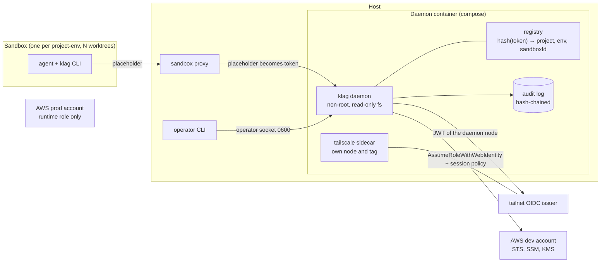

# klag specification (v4)

Package `klag` (npm), command `klag`, repository `keyless-agents`, TypeScript, MIT.
Requirements and tests: [REQUIREMENTS.md](REQUIREMENTS.md). Inputs and outputs: [INTERFACES.md](INTERFACES.md). This file holds the design only.

## 1. Goal
Let coding agents use project credentials with no static cloud keys on machines or in git, and without trusting an agent with more than one project-env keyspace.

## 2. Trust model
| Actor | Trust | Role |
|---|---|---|
| **agent** | untrusted (may be prompt-injected) | runs inside one sandbox and calls `klag` |
| **operator** | trusted, outside any sandbox | owns infra, registers sandboxes, promotes values |
| **runtime** | trusted, prod only | production service role; reads prod straight from AWS, never uses `klag` |

Dev values are burnable: scoped, revocable, rotated after a suspected leak. With `get` the agent sees the value and can send it wherever the sandbox network allows, so egress control belongs to the sandbox runtime.

## 3. Architecture
The daemon runs in a container with its own tailnet node, so its identity is not the host's.

Prod is a separate AWS account that no dev role can reach. The daemon has no prod code path. Sandboxes never join the tailnet, hold no AWS identity and must not reach the issuer or the tailnet range; only the daemon's container does.

### 3.1 Flows
Registration (once per sandbox):
```mermaid
sequenceDiagram
  participant O as operator
  participant D as daemon
  participant K as host secret store (sandbox runtime)
  participant S as sandbox
  O->>D: klag op sandbox add S project
  D->>D: store hash(token) → {project, dev, S}
  D-->>O: token, printed once
  O->>K: pipe the token into set-custom --sandbox S
  O->>S: start the sandbox; the orchestrator starts the agent
```
Request (`get` shown; `list` and `set` take the same path):
```mermaid
sequenceDiagram
  participant A as agent (sandbox)
  participant P as sandbox proxy (host)
  participant D as daemon
  participant I as tailnet issuer
  participant W as AWS
  A->>P: get NAME + auth placeholder
  P->>D: same request, placeholder replaced by the token
  D->>D: hash(token) → {project, dev, S}; normalize NAME; policy; rate limit
  D->>I: request a JWT (sub = daemon node)
  I-->>D: JWT
  D->>W: AssumeRoleWithWebIdentity + session policy
  W-->>D: temporary credentials (cached until shortly before expiry)
  D->>W: GetParameter /project/dev/NAME
  W-->>D: value
  D->>D: audit {sandboxId, op, name, version, decision}
  D-->>A: value, or DENIED / NOT_FOUND / RATE_LIMITED
```

### 3.2 Setup
`klag op setup` prepares a host in one idempotent run; steps, flags and defaults are in [INTERFACES.md](INTERFACES.md). It acts on the host and does not use the operator socket. Rules:
- It never asks for or stores a credential: Tailscale shows its own login URL (taken from the sidecar), and the AWS side is a template that the administrator applies with the administrator's own access.
- It needs no `sudo`: the daemon is a compose project in an operator-owned state directory, and the host's own tailnet node is never touched or tagged.
- It never builds a shell command from input: processes are spawned with argument arrays, and the project name matches `^[a-z][a-z0-9-]{1,31}$`.
- It installs nothing by default: `--check` lists what is missing with the official command for the detected OS. `--install-prereqs` is opt-in, one item at a time, with the command shown first, only through the OS package manager and never through `curl | sh`; items unsupported on the OS only get instructions.
- It records everything it creates in a manifest (`manifest.json` in the state directory: `{kind, id}` per entry).
- The tag must already exist in the tailnet ACLs, so setup prints the snippet first (to validate that the sidecar fails without it).
- The AWS stack is applied later by an administrator, so setup ends with exit `7` ("waiting for the administrator") and prints the `klag op doctor <project>` command; a green doctor is checked end to end separately.
- A human supplies three values: the region, the project name and the AWS account ID (12 digits). The template fixes the role name (`{project}-dev-agent`), so the role ARN is derived from the account ID and confirmed by a real STS exchange.

### 3.3 Removal
`klag op remove-all` removes the installation (flags and output in [INTERFACES.md](INTERFACES.md)). Rules:
- It prints the exact effects first and refuses to run without an explicit confirmation: typing the hostname, or `--yes --confirm <hostname>` when non-interactive. `--yes` alone is refused.
- It removes only the entries of the manifest, each one after the item is deleted, so a rerun resumes where a failure stopped. A pre-existing file or container is never touched.
- It keeps the audit log unless `--purge-audit`: the log is exported out of the volume to the state directory before the volume is removed.
- It never touches what it cannot own: AWS (stack, role, KMS key, parameters), Tailscale (node, tag, issuer) and the sandbox runtime with its stored tokens. It prints the steps the administrator must take there, including that deleting the stack schedules the KMS key for deletion, after which the stored `SecureString` parameters become unreadable.
- It is idempotent.

## 4. Identity binding
- The daemon is reached through the host-side proxy of the sandbox runtime. The proxy replaces a placeholder in the request's `auth` field (body or header, never the query string) with a **per-instance token** scoped to that sandbox (`sbx secret set-custom … --sandbox`, experimental). The agent never sees the token.
- The registry stores `hash(token) → {project, env, sandboxId}` and is the only source of the keyspace. A request carrying `project` or `env` is `INVALID` and audited as an anomaly. An unreplaced placeholder or unknown token is `DENIED`, audited with `decision: alert`.
- `klag op sandbox add` prints a random token (≥128 bits) once. It lives as long as the sandbox; `op sandbox revoke` deletes the hash.
- The AWS identity is the daemon node's JWT. Host processes have another tailnet identity (their own `sub`) and cannot assume the role; the daemon restricts sandboxes only. The sandbox network policy must deny the issuer and the tailnet range, and `op doctor` verifies that the issuer is unreachable from inside a sandbox.
- The operator socket is a file with mode 0600 in an operator-owned directory; filesystem permission is the operator authentication. Members of the `docker` group can reach the container and are therefore operators. Until every agent runs in a real sandbox the host is outside the trust model (P8): without a registry entry the daemon serves nobody.

**Granularity.** The boundary is the keyspace and all worktrees of a project-env share it, so one sandbox serves one project-env and many worktrees; splitting adds no secret isolation and only more memory.

## 5. Keyspaces and operations
Two scopes per project-env: **shared** `/{project}/dev/<name>` (written by the operator) and **agent** `/{project}/dev/agent/<name>`.

| Operation | Agent | Operator |
|---|---|---|
| `list` | names of both scopes, no values | all configured environments (never prod) |
| `get` | value; shared wins over agent | any |
| `set` | agent scope only | any dev path |
| `promote` | no | copies an agent value into shared |
| `delete`, `sandbox revoke` | no | yes |

The agent has no environment flag: its environment is fixed by the registry, so prod does not exist for it. The operator's environment defaults to `dev`; others only if configured. Names: `/{project}/{env}/{name}`; names starting with `aws` or `ssm` are rejected (SSM limit); depth ≤ 15; no paths shared across projects.

## 6. AWS layout (created by the infra template)
- **Accounts**: dev and prod are separate; the dev role has no trust or action toward prod.
- **Role per project-env** (`{project}-dev-agent`): `ssm:GetParameter(s)` and `GetParametersByPath` on `parameter/{project}/dev/*`; `PutParameter` only on `parameter/{project}/dev/agent/*`; explicit `Deny` on delete, on any prod path and on other projects. A permission boundary caps the role. `DescribeParameters` is not granted (it lists names of every project).
- **KMS**: one key per project-env, key policy naming only its roles, `kms:ViaService = ssm.<region>.amazonaws.com`, `Decrypt` only for the read role.
- **Trust**: the role trusts the tailnet issuer with exact `aud` and the daemon node's `sub`. No human login, no stored token. The issuer (`tsidp` is experimental, `tsiam` is third-party) must be reachable by AWS to fetch its public keys; the spike M19 proves this. There is no fallback: if the spike fails, the design returns to the owner. Publishing the npm package uses GitHub OIDC; the daemon never does.
- **Store**: SSM `SecureString`. The daemon forces the type and the project key (IAM has no condition for the type, to validate); CloudTrail shows other types written outside the daemon. Rotation is out of the MVP.
- The template is CloudFormation, generated by `klag op setup` with the values filled in; a CDK construct may render the same resources. Templates and automation hold names and paths only.

## 7. Audit, limits, revocation
- Audit: JSONL, append-only, each line holds the previous hash, kept in the daemon's volume and written only by the daemon (0600). `op audit verify` runs through the operator socket, since the daemon reads the log. Fields: timestamp, sandboxId, operation, name, version, decision. Never values. CloudTrail is the independent record.
- Rate limit per sandbox with burst. A `list` sweep followed by `get` of every name raises an alert, which in the MVP is an audit line with `decision: alert`.

## 8. Hygiene
- `set` reads the value from stdin or a no-echo prompt, never argv. Values never appear in argv, logs, errors, stack traces, process title or audit. AWS SDK errors are sanitized.
- The daemon container runs as non-root with a read-only filesystem, all capabilities dropped, `no-new-privileges`, core dumps disabled and no Docker socket mounted. The daemon binds only the container's bridge interface, never the tailnet interface, and the tailnet ACL grants no inbound access to the daemon tag; the port is published on host loopback only. The VM → proxy hop is plain HTTP inside the sandbox network (accepted).
- `process.env` is read only in the config module (`KLAG_CONFIG`, `KLAG_URL`, `KLAG_OP_SOCKET`, plus the placeholder variable once the sandbox runtime fixes its name).
- There is no `klag login`: nothing is stored on login. The sidecar joins the tailnet through Tailscale's own login URL and AWS access comes from the issuer; `klag op doctor` verifies the chain.

## 9. Supply chain
npm trusted publishing (GitHub OIDC, no npm token) with provenance; lockfile, exact versions, minimal runtime dependencies, Actions pinned by SHA, 2FA, secret scanning in CI.

## 10. To validate before coding
- One sandbox serving several Orca worktrees, and how the orchestrator starts agents inside it.
- The sandbox proxy reaching the daemon, the name under which the sandbox sees it (`KLAG_URL`), and `set-custom` (experimental) replacing the placeholder in a header or body.
- Spike M19: issuer reachable by STS, `AssumeRoleWithWebIdentity` pinned to the daemon node, session-policy behavior.
- The tailscale sidecar logging in through a URL without an auth key, keeping its node in a volume, and the ACL tag requirement.
- **Tailnet hardening for the daemon node (Tailworm report, 2026-10-25, no Tailscale bulletin yet):** the sidecar node must run with Tailscale SSH disabled (`--ssh=false`), no `tailscale serve`/Funnel, no app-connector entitlement, node-key expiry on, and a dedicated tag whose ACL/grants allow only the OIDC/STS egress and the sandbox→daemon path (per-pair grants, never tag-wide SSH). Lock reviews the sidecar config and the ACL diff before M19 is accepted; the squad's tailnet review (`infra/.superpowers/sdd/lock-tailscale-report.md`) is the input.
- The daemon's bind and the host-loopback publish through the sidecar's network namespace.
- Linux support of the sandbox runtime outside Ubuntu (best effort until tested).
- npm trusted-publishing setup for a new package.
